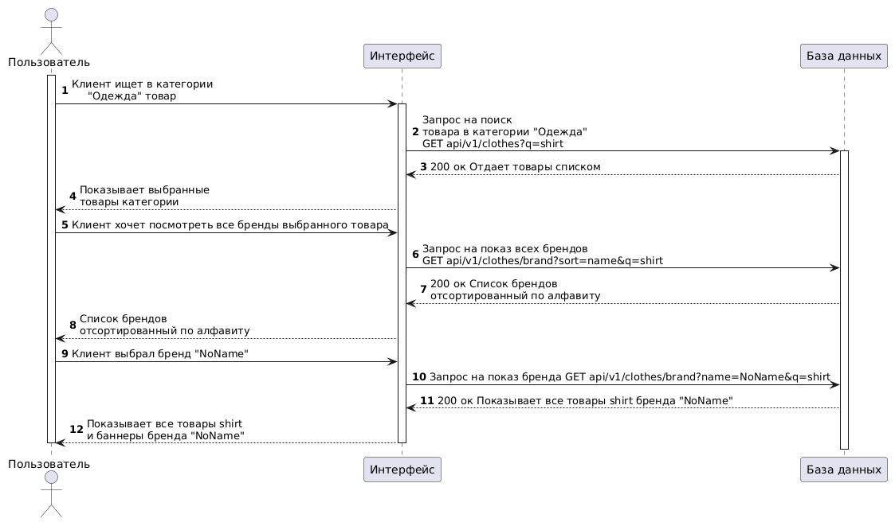

@startuml

Actor "Пользователь" as client
Participant "Интерфейс" as front
Participant "База данных" as back

autonumber

activate client
client -> front: Клиент ищет в категории\n     "Одежда" товар
activate front
front -> back: Запрос на поиск\nтовара в категории "Одежда"\nGET api/v1/clothes?q=shirt
activate back
front <-- back: 200 ок Отдает товары списком
client <-- front: Показывает выбранные\nтовары категории
client -> front: Клиент хочет посмотреть все бренды выбранного товара
front -> back: Запрос на показ всех брендов\nGET api/v1/clothes/brand?sort=name&q=shirt
front <-- back: 200 ок Список брендов\nотсортированный по алфавиту
client <-- front: Список брендов\nотсортированный по алфавиту
client -> front: Клиент выбрал бренд "NoName"
front -> back: Запрос на показ бренда GET api/v1/clothes/brand?name=NoName&q=shirt
front <-- back: 200 ок Показывает все товары shirt бренда "NoName"
client <-- front: Показывает все товары shirt\nи баннеры бренда "NoName"
deactivate back
deactivate front
deactivate client

@enduml
